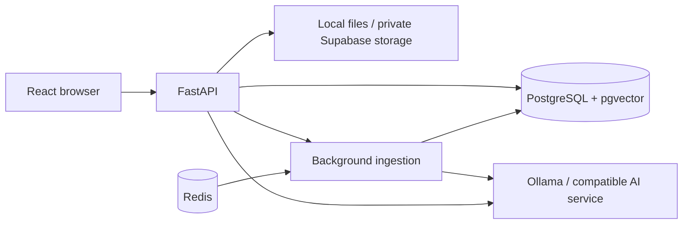

# DocuQuery

Document question answering with source citations. React and TypeScript provide the UI; FastAPI handles accounts, uploads, retrieval and streaming answers. PostgreSQL stores accounts, document metadata, chunks, vectors and conversations. Redis supports rate limiting and production background jobs. Ollama provides local embeddings and answers.

## Status

Local development application with production deployment configuration. Public hosting, backup restoration and hosted AI acceptance remain pending. See [verification](docs/verification-results.md) and [limitations](docs/known-limitations.md). Citations help verify answers; they do not guarantee factual accuracy.

## Run locally on Windows

Start Docker Desktop and Ollama. From this directory:

```powershell
docker compose up -d db redis
cd backend
.\.venv\Scripts\python.exe -m alembic upgrade head
.\.venv\Scripts\python.exe run.py
```

In another terminal:

```powershell
cd C:\projects_and_portfolios\DocuQwery\docuquery\frontend
npm run dev -- --host 127.0.0.1
```

Open http://127.0.0.1:5173. Keep both terminals open. The API health check is http://127.0.0.1:8100/api/health. Required local models are `qwen2.5:3b` and `nomic-embed-text`; install them with `ollama pull MODEL` if absent. Port 8100 already in use means an existing server needs checking before starting another.

For first installation: install Python 3.12+, Node.js 24, Docker Desktop and Ollama; create `backend/.venv`, install `pip install -e .` inside backend, copy `.env.example` to `.env` without overwriting an existing configuration, and run `npm ci` inside frontend. Tesseract is required for scanned PDF OCR. Never commit `.env` or credentials.

## Architecture



Uploads are validated, stored, parsed and split into chunks. Embeddings and full-text indexes support retrieval. Chat retrieves authorized chunks and streams an answer with citations. Local mode runs ingestion in the API process; production uses Celery workers and Redis.

## Code map

| Location | Responsibility |
|---|---|
| `frontend/src/pages` | Documents, chat, extraction and analytics screens |
| `frontend/src/api.ts` | HTTP requests, errors and session refresh |
| `backend/app/api` | Request validation and API routes |
| `backend/app/services` | Authentication, authorization, retrieval, parsing and storage |
| `backend/app/db` | Models and database sessions |
| `backend/app/workers` | Ingestion jobs and recovery |
| `backend/migrations` | Versioned database schema changes; do not delete |
| `backend/tests`, `backend/tests_integration`, `frontend/e2e` | Automated verification |

## Accounts and isolation

Uploads are private by default. With `PUBLIC_DOCUMENT_SHARING_ENABLED=False` (the default), ordinary accounts only list and retrieve their own documents, including older uploads labelled public. Logged-out users see no documents. Administrators retain privileged direct access. Public sharing is an explicit optional configuration, not the default. No existing uploads or ownership records are deleted by this setting.

Access tokens authenticate requests; HttpOnly refresh cookies rotate sessions. Logout clears the UI session. Account changes remount all pages so cached content is discarded. Switching tabs within one account preserves visited pages; processing documents still poll until ready and health checks run periodically.


## Verification commands

From frontend: `npm run build` and `npx playwright test e2e/session.spec.ts`.
From backend: `.\.venv\Scripts\python.exe -m unittest discover -s tests -v`.
Integration tests use the disposable local `docuquery_test` database; never point them at user data.

## Answer evidence and confirmations

Deleting a document and signing out require confirmation. Cancel sends no mutation request.

Retrieved excerpts are candidates, not citations. The API buffers the draft, checks all claims against cited excerpts with a second model call, and requires verbatim evidence quotes before publishing. Only used sources appear in citation cards, with the checked quotation as the preview. Missing evidence produces a refusal without citations; verifier outages produce an error rather than releasing the draft. Citation numbers retain their original excerpt numbers. Existing saved conversation answers are not rewritten; start a new conversation to test the new policy.

This increases response time and model usage. Model verification can still make mistakes; a matching quotation alone does not prove that an inference is correct. Evaluate representative answerable and unanswerable questions before deploying. The optional answer cache now requires the exact question and matching model/prompt/tenant/document scope; it remains disabled by default.


For compound questions, supported parts are answered with citations and missing parts should be identified explicitly. A partial answer is not automatically refused. Extract supports invoice and contract templates, previews expected fields, labels missing values and allows CSV/JSON export. Its confidence label is the model's estimate, not a calibrated accuracy score. Review extracted values against the source before using them in business workflows. See [the timed portfolio demonstration script](docs/demo-script.md).
