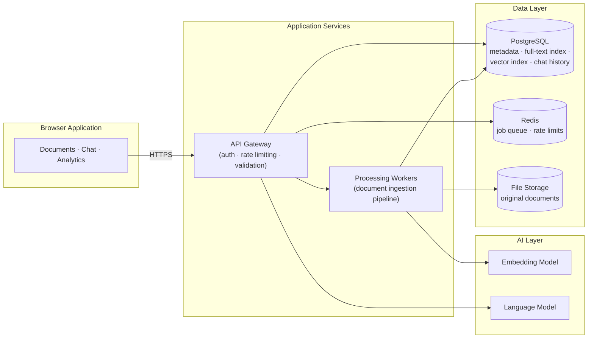
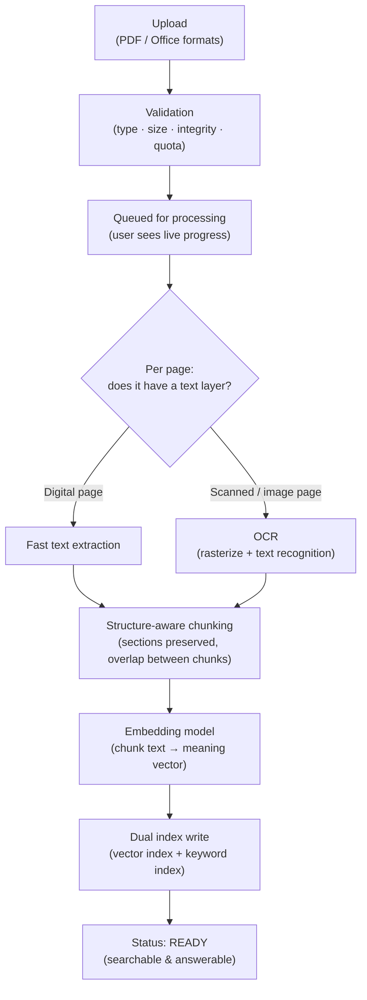
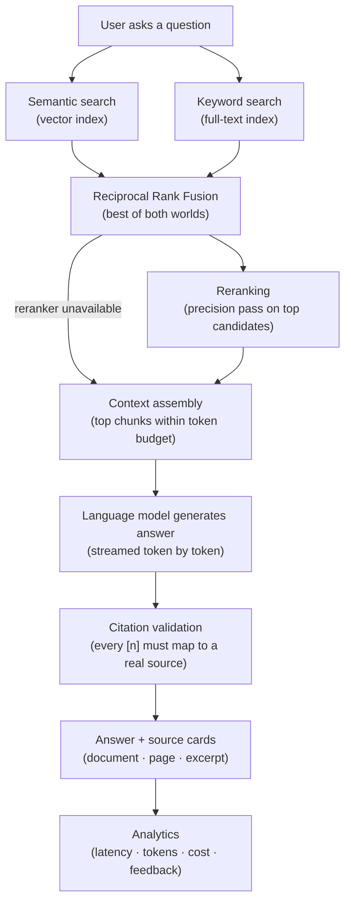
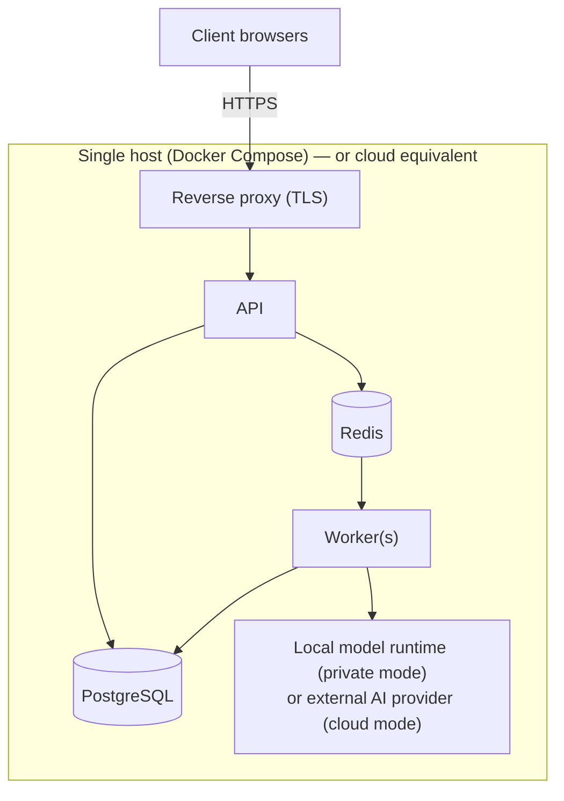

# DocuQuery — System Architecture & RAG Workflow

> **Audience:** clients and technical stakeholders. This document explains how DocuQuery
> works end-to-end at a conceptual level — no source code, no implementation internals.
> Pair it with [SECURITY_MODEL.md](SECURITY_MODEL.md) and [TESTING_STRATEGY.md](TESTING_STRATEGY.md)
> for the full picture.

---

## 1. What DocuQuery is (one paragraph)

DocuQuery is a document intelligence platform: your team uploads documents — contracts,
handbooks, reports, invoices, including **scanned paper digitized as images** — and then
asks questions in plain language. It answers **in real time, word by word**, and every
claim in the answer is **linked to the exact document and page** it came from, so anyone
can verify the answer in one click. It runs **entirely inside your infrastructure**: no
document content ever leaves your network unless you explicitly point it at a cloud
model provider.

---

## 2. High-level system map



Every box is a standard, well-supported technology — there is nothing exotic to operate,
and every AI component sits behind a provider abstraction, so the deployment can run
**fully local** (private by default) or point at a cloud provider with a configuration
change.

---

## 3. The two pipelines

DocuQuery has exactly two workflows: **ingestion** (documents in) and **question
answering** (answers out). Understanding these two is understanding the whole system.

### 3.1 Ingestion pipeline — "documents in"



**Step by step:**

1. **Validation** — file type, size, and integrity checks before anything touches the
   pipeline. Invalid or hostile files are rejected with a clear message.
2. **Background processing** — the upload returns immediately; heavy work happens in
   workers, with live progress (0–100%) visible in the UI.
3. **Smart OCR fallback** — each page is inspected individually. Digital pages are read
   instantly from their text layer; scanned pages are automatically rasterized and run
   through OCR. A mixed document (part digital, part scanned) needs **no manual flags**.
4. **Structure-aware chunking** — text is split at section and paragraph boundaries into
   overlapping chunks sized for retrieval. Headings travel with their content, so a
   chunk from "Section 4.2 — Parental Leave" knows where it lives.
5. **Dual indexing** — every chunk is stored twice: once as a **meaning vector**
   (semantic: "concepts like this") and once in a **keyword index** (lexical: "exact
   terms like invoice numbers, part codes, names"). This dual index is what hybrid
   retrieval draws from.
6. **Status tracking** — every document has a live status: `processing → ready` or
   `failed` with a human-readable reason, plus a retry action.

### 3.2 Question-answering pipeline — "answers out"



**Why hybrid retrieval matters (the core differentiator):**

| Question type | Pure semantic search | Pure keyword search | DocuQuery hybrid |
|---|---|---|---|
| "What is our parental leave policy?" | ✅ great | ⚠️ misses paraphrases | ✅ |
| "What is the amount on invoice INV-2026-089?" | ⚠️ fuzzy on exact codes | ✅ great | ✅ |
| Domain jargon, part numbers, names | ⚠️ weak | ✅ strong | ✅ |

Both searches run in parallel, their ranked results are **fused** (Reciprocal Rank
Fusion — a standard, deterministic algorithm), and the top candidates optionally pass
through a **reranker** — a second, more precise model that re-sorts the shortlist.

**Grounding and honesty:** the model is instructed to answer *only* from the provided
excerpts and to cite each claim as `[1]`, `[2]`. If the documents don't contain the
answer, it must say so — DocuQuery is designed to **refuse rather than invent**. After
generation, a validation pass strips any citation marker that doesn't map to a real
source. Every answer is logged with its retrieval and generation timings and token
usage, powering the analytics dashboard.

---

## 4. Component responsibilities

| Component | Responsibility | Notes |
|---|---|---|
| **Web application** (React + TypeScript) | Upload with drag-and-drop, live ingestion progress, streaming chat UI, citation cards, analytics dashboard | Talks to the API over HTTPS; renders answers token-by-token |
| **API service** (FastAPI, Python) | Auth, validation, rate limiting, orchestration of retrieval + generation, all REST endpoints incl. streaming | Stateless — scales horizontally |
| **Processing workers** (Celery) | Document ingestion: extraction, OCR, chunking, embedding, indexing | Background so uploads never block; retries and failure states managed |
| **Embedding model** | Converts text into meaning vectors | Local by default (private); swappable via config |
| **Language model** | Generates answers from the retrieved context | Local by default; swappable via config |
| **PostgreSQL + pgvector** | Single source of truth: documents, chunks, both indexes, users, chat history, audit | One database — simpler ops, transactional consistency |
| **Redis** | Job queue for workers, distributed rate limiting, caches | |
| **File storage** | Original documents | Local disk or S3-compatible object storage |

---

## 5. Data model (conceptual)

```
User ──owns──> Document ──contains──> Chunk (text + vector + page + section)
 │                    │
 ├──> Workspace ──────┘          (team folders with roles: owner/member/viewer)
 └──> Conversation ──> Message (question/answer + citations + token usage)

QueryLog: one row per answered question — fuels the analytics dashboard
AuditLog: one row per security-relevant action — fuels compliance review
```

- **Chunks** carry their page number and section path — this is what makes page-level
  citations possible.
- **Chat history** is per-user and scoped, so conversations only ever see the documents
  their owner is allowed to see.
- **QueryLog / AuditLog** give operational visibility and a compliance trail.

---

## 6. Retrieval quality — measured, not claimed

DocuQuery ships with an **automated evaluation harness**: a golden dataset of
question → expected-document/page pairs across contracts, HR policy, invoices, and a
dense academic paper. On every release, the pipeline is scored:

| Metric | Meaning | Current baseline |
|---|---|---|
| **Hit rate @ top-1** | Correct document+page as the very first result | 85% |
| **Hit rate @ top-3** | Correct result within top 3 | 95% |
| **Hit rate @ top-6** | Correct result within top 6 | **100%** |
| **Avg retrieval time** | Time to search + fuse + rank | ~8 ms (local) |
| **Faithfulness** | Answer grounded in sources (token-overlap + LLM-graded) | gated in CI |

The evaluation runs in CI as a **regression gate**: if retrieval quality drops below
threshold, the release fails. Quality is enforced, not aspirational.

---

## 7. Deployment topology



- **One-command deploy**: `docker compose up` brings up the full stack with health
  checks and automatic migrations.
- **Private mode (default)**: models run locally — zero document content leaves the host.
- **Cloud mode**: change three configuration lines to use a hosted model provider
  (OpenAI / Anthropic / Z.ai compatible). No code changes.
- **Scaling path**: the API is stateless (add replicas behind the proxy); workers scale
  independently of API traffic; PostgreSQL is the single stateful component.

---

## 8. What makes this production-grade (summary)

1. **Dual-index hybrid retrieval** with deterministic fusion and graceful degradation
   (semantic+keyword → keyword-only → honest failure).
2. **Honest AI**: strict grounding, citation validation, explicit refusal over invention.
3. **Privacy-first**: fully local deployment; provider-agnostic AI layer.
4. **Asynchronous, resilient ingestion** with live progress, retries, and per-page error isolation.
5. **Measured quality**: golden-set evaluation plus a 108-test automated suite
   (56 unit + 52 integration against a real database), including a dedicated
   tenant-isolation regression suite.
6. **Observable & auditable**: latency/token/cost analytics per question, audit trail,
   request correlation IDs, security headers.
7. **Operationally boring** (a compliment): one-command Docker deploy, standard
   components, single database, horizontal scaling path.

See [SECURITY_MODEL.md](SECURITY_MODEL.md) for the security architecture and
[TESTING_STRATEGY.md](TESTING_STRATEGY.md) for how quality is continuously proven.

---

## 9. Editions — one architecture, three packages

The system ships in three editions sold to different client segments. The architecture
is identical; the edition configuration activates feature surfaces:

| Surface | Starter | Professional | Enterprise |
|---|:---:|:---:|:---:|
| PDF ingestion, OCR, hybrid chat, citations, conversations | ✅ | ✅ | ✅ |
| Tenant isolation, rate limiting, sanitized errors, security headers | ✅ | ✅ | ✅ |
| Usage & cost analytics, 14-day daily series | — | ✅ | ✅ |
| Semantic answer cache (cost optimization) & quotas | — | ✅ | ✅ |
| Answer feedback loop, search-within-documents | — | ✅ | ✅ |
| Admin console (users, global analytics, document triage) | — | — | ✅ |
| Audit trail & full auth lifecycle (rotation, revocation, lockout) | — | — | ✅ |

Core security is never an edition feature — it is correctness, present everywhere.
Unavailable surfaces return "not found": a lower edition never advertises what it
doesn't include. Details in [PRODUCT_OVERVIEW.md](PRODUCT_OVERVIEW.md).
